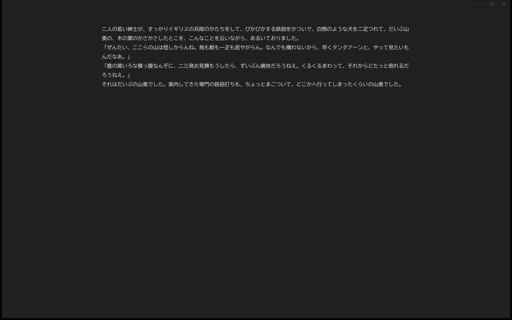
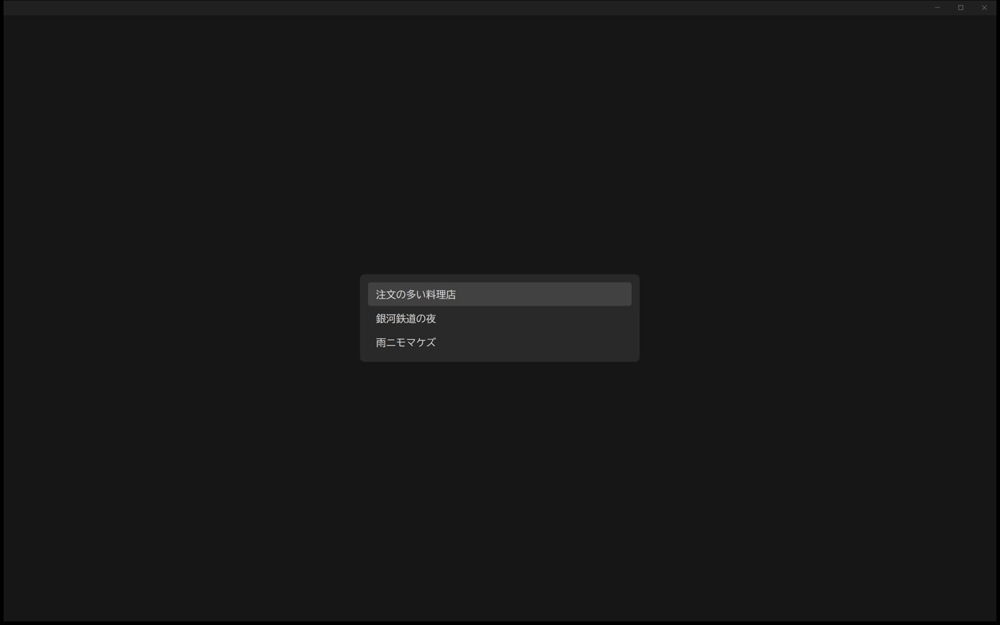

# minimal-editor

AIから離れて、静かに文章を書くための軽量なエディターです。Windows 用のネイティブアプリです。



## 考え方

設定画面を持ちません。フォント、配色、保存のしかたはすべて決め打ちにして、書くこと以外に考えることを減らしています。AI 機能もクラウド同期もありません。

## できること

- **自動保存**：入力するたびに保存し、手動で保存する操作はありません。保存は別スレッドで行うので、保存中も入力が止まりません。IME で変換している間は保存を待ち、確定してから保存します
- **複数のメモ**：名前は1行目から自動で付きます

| キー | 動作 |
|---|---|
| Ctrl+N | 新しいメモ |
| Ctrl+P | メモの一覧 |
| Ctrl+Shift+P | アーカイブの一覧 |
| Ctrl+M | 名前を変える |
| Delete（一覧で） | アーカイブする（8秒以内なら Ctrl+Z で戻せる） |

- **消えない仕組み**：保存の直前のバックアップ、60秒ごとの版の履歴、ほかのプログラムが同じファイルを書き換えたときの退避先を持つ
- **二重に開かない**：すでに開いていれば、そのウィンドウを前に出す
- 英字は Intel One Mono、日本語は BIZ UDGothic で表示します



## 作る

Windows と Rust（`rustc`）が必要です。外部のクレートは使っていません。

```powershell
git clone https://github.com/morikawa976321/minimal-editor.git
cd minimal-editor
powershell -ExecutionPolicy Bypass -File scripts/build-native.ps1     # build/native-next.exe ができる
powershell -ExecutionPolicy Bypass -File scripts/install-shortcut.ps1  # スタートメニューに登録（任意）
```

登録すると、Win キー → `minimal-editor` → Enter で開きます。登録しない場合は `ネイティブ版.vbs` を開きます。

メモは `data/native-next/memos/<ID>.txt`（UTF-8 のテキスト）に保存されます。`data/` は Git の管理外です。

## 構成

Rust と Win32 API（Rich Edit コントロール）で書いています。採用版のソースは `prototypes/native-next/` です。

試作の段階では複数の方式を並べて作り、実際に使い比べてから1つに決めました。比べた残りの版も残しています。

| 版 | 方式 |
|---|---|
| 採用版 | Rust + Win32 Rich Edit |
| A | ブラウザ（HTML の textarea を Edge のアプリウィンドウで開く） |
| B | Rust + Win32 EDIT |
| C | Python + Tk |

## 文書

- [docs/DEVELOPMENT.md](docs/DEVELOPMENT.md) — 再構築、試験の走らせ方、旧版の扱い
- [docs/shortcuts.md](docs/shortcuts.md) — キー操作の一覧
- [docs/native-comparison.md](docs/native-comparison.md) — 版の比較

## ライセンス

[MIT](LICENSE)
